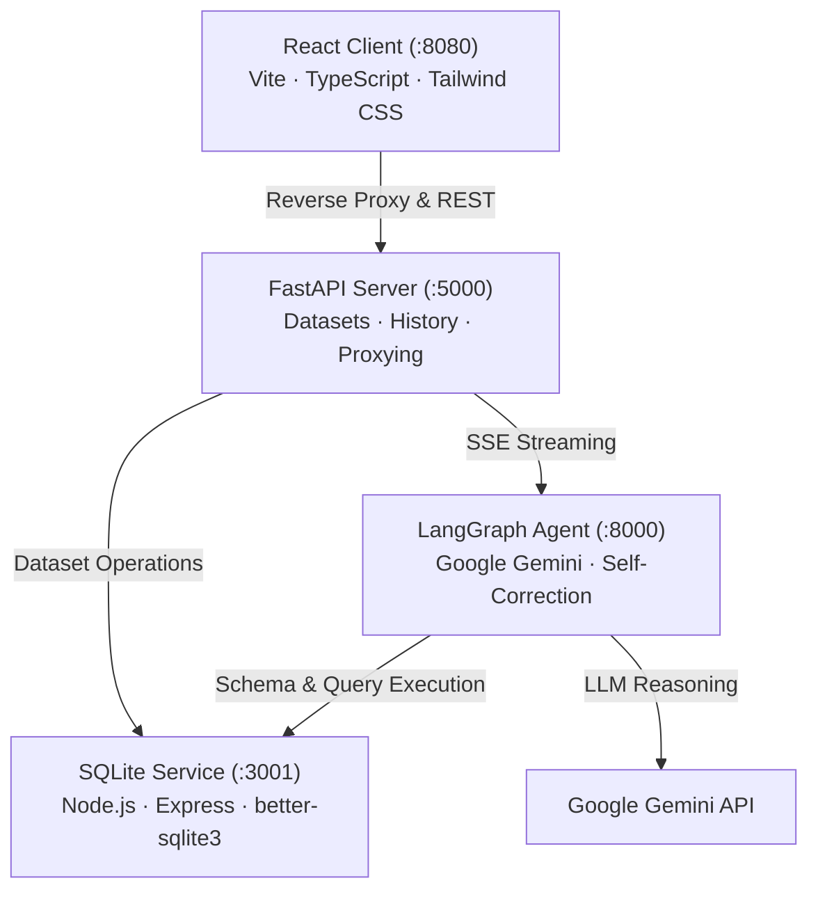

# QueryBot

QueryBot is an open-source natural language data analysis platform. It allows users to upload datasets (CSV, SQLite databases, or SQL files) and ask questions in plain English to immediately receive verified SQLite queries, statistical data analysis, executive summaries, interactive tables, and charts.

## Features

- **Direct Playground Access**: Open public workspace without required login or onboarding screens.
- **Automated Data Profiling**: Instantly profiles schemas upon upload in SQL—inferring column data types, identifying missing values, detecting cardinalities, spotting anomalies, and mapping correlations between numeric columns.
- **Self-Correcting Text-to-SQL Engine**: Powered by Google Gemini and LangGraph. When a generated query causes an execution error, the database error message is fed back to the model for automatic query repair (up to two retries).
- **Multi-File Cross-Dataset Analytics**: Upload and append multiple SQL or CSV files into a unified dataset session to query and compare metrics across disparate domains.
- **Conversational Restyling & Multi-Turn Context**: Preserves session history across queries. Supports conversational charting commands (such as "make it a pie chart", "use teal colors", "limit to top 5") without re-running full query cycles.
- **Automated Statistical Insights**: Computes descriptive statistics (mean, standard deviation, min/max spreads, and distribution caveats) alongside plain-English business interpretation.
- **Interactive SQL Inspection & Live Execution**: View the exact SQLite query used to derive the answer, edit it directly in the UI, and re-execute it on the fly.
- **Automated Visualizations**: Selects and generates appropriate charts (bar, horizontal bar, pie, line, scatter) rendered via Matplotlib and Seaborn.
- **Dashboard Pinning**: Pin answers, tables, or charts as modular tiles to a customizable dashboard.
- **Multi-Format Export**: Export analysis data to CSV, Excel (.xlsx), and JSON, or export reports to PDF, Markdown, and PNG chart images.
- **Safe Read-Only Execution**: Restricts database execution to single, read-only `SELECT` / `WITH` statements against isolated SQLite instances.

## How It Works

1. **Ingestion & Profiling**: Uploaded CSV files or SQL dumps are sanitized, loaded into isolated SQLite instances by the SQLite service, and profiled for structural and statistical properties.
2. **Question Classification**: The LangGraph agent classifies the user question into chart, table, general lookup, or styling follow-up against the schema.
3. **Schema Linking & Value Sampling**: Relevant tables and distinct categorical label values are sampled from the database to prevent hallucinations in filter clauses.
4. **SQL Generation & Validation**: The agent writes a SQLite query conforming to strict dialect rules, validates table and column identifiers, and sends it to the SQLite service.
5. **Execution Guided Self-Correction**: If SQLite raises an error, the error traceback is routed to a repair node that rewrites the query.
6. **Insight & Visualization Synthesis**: Executed row data is converted into natural language answers, business narratives, statistical callouts, and Base64-encoded charts.

## Architecture



## Screenshots

### 1. Dataset Dropzone

*Initial Playground interface for dropping CSV, SQLite, or SQL files up to 100MB.*

### 2. Automated Data Profiling

*Automated data profiling showing column health warnings, single-value alerts, and numeric correlations.*

### 3. Interactive Schema Browser

*Live schema browser displaying tables, column data types, row counts, and primary keys.*

### 4. Natural Language Analysis

*Natural language answers with business interpretation narrative and recommended follow-up questions.*

### 5. Automated Statistical Insights

*Automated key findings detailing totals, means, standard deviations, and anomaly distributions.*

### 6. Transparent SQL Inspection & Live Editor

*Inspection of the generated SQLite query with interactive in-browser execution.*

### 7. Auto-Generated Charts & Conversation History

*Dynamic Matplotlib chart generation with categorized session query history.*

### 8. Multi-File Cross-Dataset Queries

*Cross-dataset aggregation combining tables across multiple uploaded databases in a single query.*

### 9. Multi-Format Data & Report Export

*Exporting dataset slices to CSV, Excel, JSON, Markdown, or PDF.*

### 10. Formatted Executive PDF Report

*Generated PDF executive report with question, answer, high-resolution chart, and statistical breakdown.*

## Quickstart with Docker

### Prerequisites

- [Docker Desktop](https://www.docker.com/products/docker-desktop)
- A [Google Gemini API Key](https://aistudio.google.com/apikey)

### 1. Clone the Repository

```bash
git clone https://github.com/SarthakRawat-1/QueryBot.git
cd QueryBot
```

### 2. Configure Environment

Create or verify the `.env` files for the services:

`langgraph_agent/.env`:
```env
GOOGLE_API_KEY=your_gemini_api_key_here
LLM_MODEL=gemini-3.5-flash-lite
SQLITE_SERVICE_URL=http://sqlite-service:3001
SERVICE_TOKEN=local-shared-token
CHART_DOCKER_ENABLED=false
```

`server/.env`:
```env
DATABASE_URL=sqlite:///querybot.db
CORS_ORIGINS=http://localhost:8080,http://localhost:5173
SQLITE_SERVICE_URL=http://sqlite-service:3001
SERVICE_TOKEN=local-shared-token
LANGGRAPH_API_URL=http://agent:8000
```

`sqlite_server/.env`:
```env
PORT=3001
NODE_ENV=development
SERVICE_TOKEN=local-shared-token
CORS_ORIGINS=http://localhost:8080,http://localhost:5173
```

### 3. Build and Run

```bash
docker compose up --build -d
```

### 4. Access the Application

Open your browser at:
```text
http://localhost:8080
```

To stop all services:
```bash
docker compose down
```

## Service Overview

| Service | Technology | Internal Port | Host Port | Purpose |
|---|---|---|---|---|
| **Client** | React 19, TypeScript, Vite, Tailwind CSS | 80 | 8080 | Web UI and reverse proxy |
| **Server** | FastAPI, SQLAlchemy, Alembic | 5000 | 5000 | Dataset management and history API |
| **Agent** | LangGraph, Google Gemini, Matplotlib | 8000 | 8000 | Natural language to SQL and charts |
| **SQLite Service** | Node.js, Express, better-sqlite3 | 3001 | 3001 | Sandboxed SQLite storage and queries |
